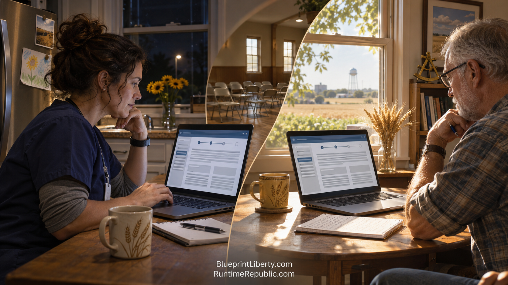

# The Old Republic Ran on Meetings

Course: The Agentic Runtime Republic
Lesson: 02 of 10
Status: Review
Runtime: about 2 minutes
Image: 02-the-old-republic-ran-on-meetings.png
Podcast: Not recorded
Sources: [AGCL Control Documents](https://github.com/RuntimeRepublic/AGCL-Control-Documents)
Approved by: —
License: CC BY 4.0

---

For most of our history, citizen government ran on three scarce things: time, rooms and gatekeepers.

If you wanted to change a property-tax law, you needed evenings free for meetings. You needed someone who knew which committee mattered and when it met. You needed the one person who controlled the mailing list, the Facebook group or the microphone. Good ideas died, not because they were wrong, but because the people who had them worked day shifts.

Think about how a typical citizen group ran, right up until 2026. A meeting was called for Thursday at seven. Half the people couldn't make it. The ones who came spent the first hour catching up on what happened last time. Someone took notes on a legal pad. The notes went home with that person and were never seen again. A month later, the same group had the same argument, because nobody could find what they had already decided.

Social media promised to fix this. It did not. It gave everyone a megaphone and nobody a workbench. Facebook groups filled up with outrage and reposts. X rewarded the sharpest insult, not the best-researched answer. Discord channels scrolled so fast that last week's decision was buried under this morning's memes. We got more noise and less finished work.

Meanwhile, the people on the other side of the table had staff. Lobbyists had research teams. Agencies had analysts. A citizen with a full-time job couldn't keep up with a professional who did this all day, every day.

The missing piece was never more talk. It was a place to build together, with a record of who did what and why. It was a way for a night-shift nurse and a retired engineer to work on the same document a day apart, without either one being left behind.

By June of 2027, that piece is starting to fall into place. The meetings haven't disappeared. But they're no longer where the work happens. They're where people check work that has already been done.

<!-- series-navigation: start -->

---

### Continue reading

[← Previous essay](../01-a-tuesday-in-june/lesson.md) · [Series index](../README.md) · [Next essay →](../03-the-runtime-where-the-work-lives/lesson.md)

[All series in this repository](../../README.md) · [Repository home](../../../README.md)

<!-- series-navigation: end -->
