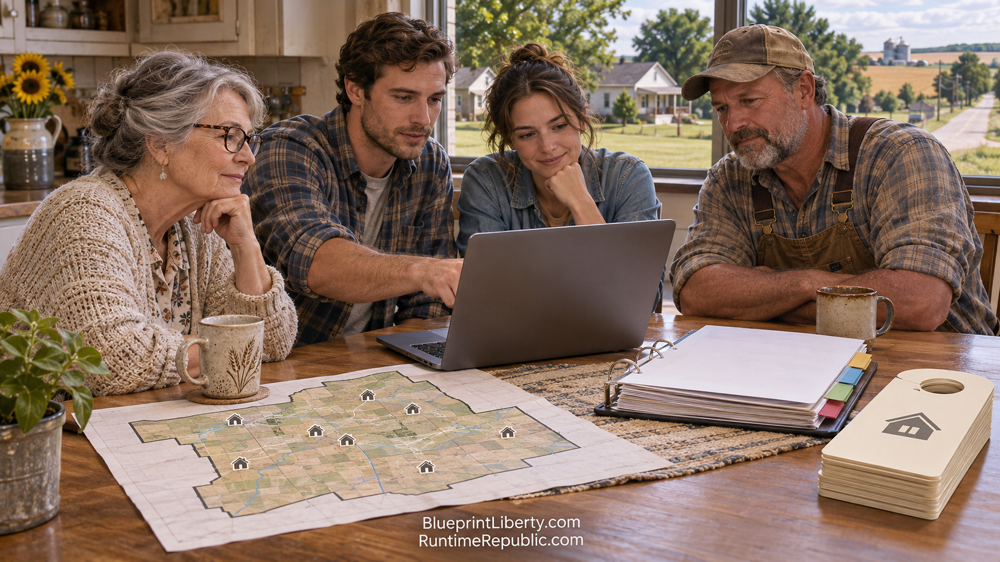

# Property Rights Groups Move First

Course: The Agentic Runtime Republic
Lesson: 05 of 10
Status: Review
Runtime: about 3 minutes
Image: 05-property-rights-groups-move-first.png
Podcast: Not recorded
Sources: [AGCL Control Documents](https://github.com/RuntimeRepublic/AGCL-Control-Documents)
Approved by: —
License: CC BY 4.0

---

The first groups to move into the runtime aren't national parties. They're people losing something they can measure.

Property owners are that group. When a family loses a home over a tax bill, the loss is concrete, local and countable. You can put it on a map. You can put a number on it. That's why property-tax coalitions became the first real citizens of the Runtime Republic.

Here's how it spread across Kansas in the first half of 2027.

It started with one county building the pilot. The Sedgwick County chapter decided to run about ninety-five percent of its work online, on its own schedule. The plan, the calendar, the sign orders and the weekly review all lived in shared tools. Meetings still happened, but only when a decision truly needed people in the same room.

The plan was written to be copied. Because the whole system lived in a repository, the second county didn't start from zero. Its members copied the Sedgwick plan, changed the county name, and got every lesson the pilot had learned. That included what didn't work, which turned out to be just as valuable.

A weekly review ran the whole thing. Plan, Do, Check, Act. What did we plan this week? What did we actually do? What did the numbers show? What do we change next week? The Guide pulled the review together before anyone sat down. The people made the calls.

The members did the walking. They ordered door hangers and yard signs, paid for them, and put them out themselves. They knocked on doors, talked after church services, and stopped neighbors at the grocery store. Every door hanger pointed back to the same place: the tracker, the Facebook group, the Discord, the video, and the sign order form.

Social media carried the signal. County Facebook groups were where neighbors heard about it. Discord was where volunteers coordinated. YouTube explained the issue. X carried it beyond Kansas. Each one pointed back to the same source of truth.

Kansas has a hundred and five counties. Under the old model, that meant a hundred and five separate efforts, each reinventing the wheel, each depending on one or two tireless people who eventually burned out. Under the new model, it means one good template and a reliable way to improve it. Every county that joins makes the template better for the next one.

That's how a movement grows without a headquarters. Nobody in Topeka has to approve a new chapter. Nobody has to hand over a password or a mailing list. A group of neighbors copies the plan, opens their Claude Projects, and gets to work.

And it starts where the AGCL says it should start, with Control 00C: property rights come first.

<!-- series-navigation: start -->

---

### Continue reading

[← Previous essay](../04-the-control-documents-become-code-like/lesson.md) · [Series index](../README.md) · [Next essay →](../06-legislators-who-move-toward-the-runtime/lesson.md)

[All series in this repository](../../README.md) · [Repository home](../../../README.md)

<!-- series-navigation: end -->
