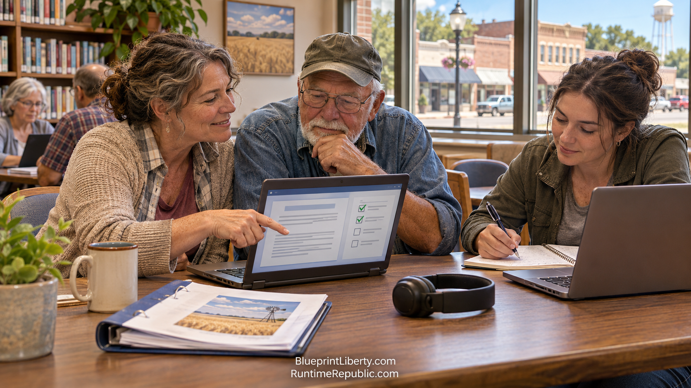

# Training the Citizens Who Run It

Course: The Agentic Runtime Republic
Lesson: 08 of 10
Status: Review
Runtime: about 3 minutes
Image: 08-training-the-citizens-who-run-it.png
Podcast: Not recorded
Sources: [AGCL Control Documents](https://github.com/RuntimeRepublic/AGCL-Control-Documents)
Approved by: —
License: CC BY 4.0

---

None of this works if only programmers can use it. The real bottleneck was never the technology. It was people who know how to work this way.

That's the job of Runtime Republic University.

The students are called Hitchhikers. On the first day, each Hitchhiker sets up a Claude Project that serves as their Guide. The Guide teaches the lessons, reads them aloud while the student follows along, gives quizzes as they go, and keeps them honest. If a student gets something wrong, the Guide doesn't just hand over the answer. It asks the next question, the way a good teacher would.

Each Hitchhiker also keeps a traveler. It's a GitHub repository that holds a record of their work: what they learned, what they built, and what they turned in. The traveler goes with them from course to course. By the end, it shows what they can actually do, not just what they said they could do.

There are three tracks, and every student works through all three. The Discord track teaches how to organize and coordinate a team. The GitHub track teaches how to build and keep a shared record. The Claude track teaches how to use an AI Guide to research, draft and check work. Each track goes one skill at a time, from beginner to capable.

The goal is simple. A graduate should be able to open a repository, read a control document, ask the Guide a good question, and submit a clean pull request. That's it. That's the whole skill set a citizen needs to take part in the Runtime Republic.

By June of 2027, the first Hitchhikers are working through the Discord track. The very first student was the founder himself, testing every lesson before anyone else had to take it. The system is also being tested in an unexpected place: helping people prepare for the Kansas commercial driver's license knowledge test. If a Claude Guide and a GitHub traveler can help someone pass a CDL exam, they can help someone understand a property-tax bill.

The learning doesn't stop at the classroom. The essays in Runtime-Republic-Training become Exit Point podcast episodes, read word for word, so people can learn on the drive to work. The videos stay short, three or four minutes, and they always point back to the written lesson. A video never replaces the reading. It walks you to it.

The founders of this country believed a republic needs citizens who can read. That's still true. But a Runtime Republic needs citizens who can read and build.

Runtime Republic University exists to make sure there are enough of them.

<!-- series-navigation: start -->

---

### Continue reading

[← Previous essay](../07-why-the-movement-speeds-up/lesson.md) · [Series index](../README.md) · [Next essay →](../09-the-honest-risks-and-the-real-test/lesson.md)

[All series in this repository](../../README.md) · [Repository home](../../../README.md)

<!-- series-navigation: end -->
