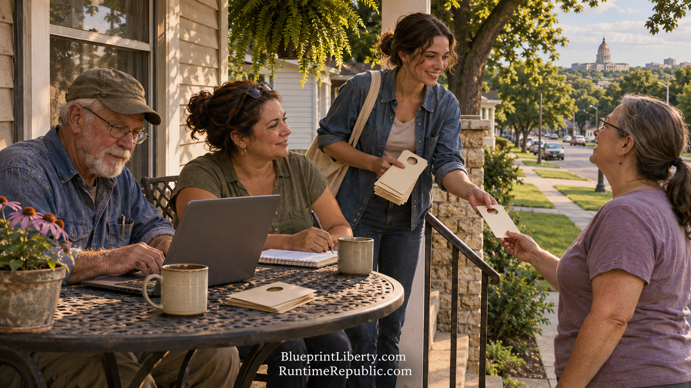

# The Republic Was Never a Building

Course: The Agentic Runtime Republic
Lesson: 10 of 10
Status: Review
Runtime: about 3 minutes
Image: 10-the-republic-was-never-a-building.png
Podcast: Not recorded
Sources: [AGCL Control Documents](https://github.com/RuntimeRepublic/AGCL-Control-Documents)
Approved by: —
License: CC BY 4.0

---

The founders didn't have GitHub. They had printing presses, committees of correspondence, and riders on horseback carrying letters from one colony to the next. Those were the runtime of their republic. They were the working system that carried ideas from town to town and turned them into action.

It was slow. A letter from Boston to Philadelphia could take days. A decision could take months. But it worked, because ordinary people kept the system running. Printers, farmers, shopkeepers and preachers did the work of self-government on top of their regular lives.

We have a faster runtime now. Agents that read and draft. Repositories that remember. Networks that reach every county by morning. And a written standard, ten controls, that anyone can read and anyone can check.

But look back at that Tuesday morning in June of 2027. The machinist approving a post from his Claude Project. The second county copying the Sedgwick plan. The aide in Topeka reading a draft that came with its own PDCA plan and review dates. The three letters about H.R. 25, and the cosponsor who signed on after them. The members walking their blocks with door hangers and talking to neighbors after church.

None of that was done by a machine alone. Every step had a person behind it who chose to show up.

The tools won't save the republic by themselves. People will. What the tools change is who gets to take part. For the first time in a long time, ordinary people can do the work of self-government on their own schedule, with their own hands, against a written standard everyone can see. And they can test the results in the lives of real families, not just in speeches.

The republic was never a building in Washington or a capitol in Topeka. It was always the people who kept it running. The buildings are just where the decisions get recorded.

The Runtime Republic isn't coming from Washington. It's being built one change at a time by citizens who decided to stop waiting for a meeting. It's in a repository anyone can read, measured against controls anyone can check, and tested by results anyone can see.

The code is open. The plan is written. The template is ready to copy.

Fork it. Improve it. Run it.

<!-- series-navigation: start -->

---

### Continue reading

[← Previous essay](../09-the-honest-risks-and-the-real-test/lesson.md) · [Series index](../README.md)

[All series in this repository](../../README.md) · [Repository home](../../../README.md)

<!-- series-navigation: end -->
