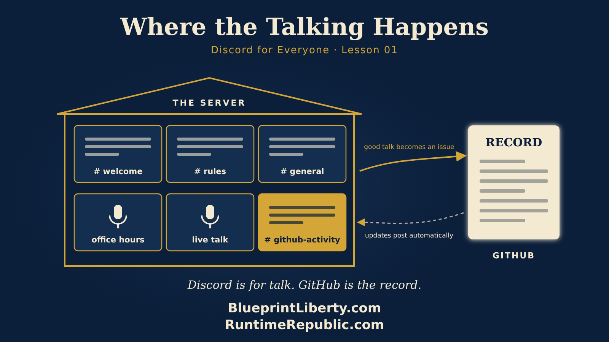

# Where the Talking Happens: Using Discord the Runtime Republic Way

Course: Discord for Everyone
Lesson: 01 of 01
Status: Draft
Runtime: about 11 minutes
Image: 01-where-the-talking-happens.png
Podcast: Not recorded
Sources: None
Approved by: —
License: CC BY 4.0

---

Welcome to Runtime Republic. Today we're going to talk about a place, not a law. That place is Discord. If you've never used it, you might think of it as something your kids or grandkids use to play video games. That's how it started. But it has grown into something bigger, and it may be one of the best tools we have for working together online. So let's look at what Discord is, where it came from, and how we can use it well.

## What Discord is

Start with a picture. Imagine a community center. The building has a name on the front. Inside there are rooms. One room is a lobby where people say hello. Another is a meeting room. Another is a workshop. There's a bulletin board by the door. And in some rooms, people sit and talk out loud.

That's Discord. The building is called a server. Anyone can create one, for free, and invite people in. The rooms are called channels. Some channels are for typing messages, like a group text that never ends. Some are for talking out loud, like a phone call you can walk into and out of. Some are for live talks, where a few people speak and everyone else listens, like a town hall.

Each person who joins can be given a role. A role is a name tag that also works like a key. One role might open the lobby only. Another might open the workshop. Another might let someone run a meeting. The server owner decides who gets which key.

That last idea matters a lot for us. We'll come back to it.

## Where Discord came from

Discord was started by Jason Citron and Stan Vishnevskiy, and it launched in May of 2015. Citron had built video game companies before. He saw a problem that every gamer knew. When friends played together online, they needed to talk while they played. The tools they had were clumsy, slow, or full of ads. Discord was built to fix that. It made voice chat fast and free, and it kept a running record of the text conversation in each channel.

Gamers loved it. Groups formed around every game you can name. But something interesting happened. People who met to play games started talking about other things: schoolwork, music, hobbies, their towns. Study groups moved in. Book clubs moved in. Software builders moved in, because a channel for every part of a project is exactly how they like to work.

Then 2020 came, and the world went home. Schools, churches, clubs and families all needed a place to gather that wasn't a room. Discord's use climbed fast. That year the company changed its message. It stopped calling itself a tool for gamers and started calling itself "your place to talk." In 2021, Microsoft reportedly talked about buying it for around ten billion dollars. Discord said no and stayed independent.

By 2025, Discord reported more than two hundred million people using it every month. That April, Jason Citron stepped down as chief executive, and Humam Sakhnini, a former executive at the game company Activision Blizzard, took his place. Reports at the time said Discord was preparing to sell shares to the public. Whatever comes next, the platform has grown up. It's no longer just a game room. It's a town square with many doors.

## Why it fits our work

Here is the core idea of everything we do at Runtime Republic. We work in the open, on GitHub, where every proposal, every comment and every change is written down and kept. That is the record. It's permanent, and anyone can check it.

But people don't only need a record. They need a place to talk. They need to ask a quick question without opening an issue. They need to say, "I don't understand this clause, can someone explain it?" They need to joke a little, get to know each other, and feel like part of a team. A record is a filing cabinet. People can't live in a filing cabinet.

So here is the rule that makes Discord work for us, and it's the most important sentence in this essay. **Discord is for talk. GitHub is the record.**

If a good idea comes up in Discord, it doesn't count until it's written down in GitHub. Talk turns into an issue. An issue turns into a proposal. A proposal is reviewed and approved in the open. Nothing is decided in Discord. No votes. No final word. Just conversation that feeds the work.

## Ideas for using Discord well

Let's brainstorm. Here are ways we might shape a Runtime Republic server.

**First, organize it like our teams.** On GitHub, our teams nest inside each other. There's a national team, then a Kansas team, then a team for PRJ-002, the One-Hour Rule. Discord can mirror that. Channels can be grouped into categories, so there might be a National category, a Kansas category, and inside Kansas, a section for the One-Hour Rule. When someone joins, they can see the shape of the whole effort at a glance.

**Second, use roles that match our levels.** On GitHub, volunteers work up through levels. They don't skip ahead. Discord roles can follow those same levels. A new visitor might see only the welcome channel and the rules. Once someone reaches Level 1, a role opens the working channels. Higher levels might open rooms where drafts are discussed in detail. The key fits the level, and the level is earned in the open.

**Third, connect GitHub to Discord.** GitHub can post into a Discord channel automatically. We could have a channel called "github-activity." Every time someone opens an issue, leaves a comment, or a change gets merged, a short note appears there with a link. Nobody has to copy anything by hand. People who live in Discord can see the record moving, and the link always sends them back to the real thing.

**Fourth, hold office hours.** Pick an evening each week. Open a voice channel. Anyone stuck on a lesson, a quiz question, or setting up their AI assistant can drop in and ask. A volunteer at a higher level can help. It's like a help desk with a friendly face.

**Fifth, use live talks for teaching.** Discord's stage channels let one or two people speak while many listen, and listeners can raise a hand to ask a question. This is a natural fit for reading a draft aloud, clause by clause, and taking questions as you go. Afterward, the good questions become GitHub issues so they're not lost.

**Sixth, give each issue its own room.** We organize our work by issues, like property tax or legislative transparency, and by principles, like taxpayer supremacy. A channel for each issue lets people who care about the same cause find each other. The property tax group can talk property tax. The transparency group can talk about the one-hour rule.

## The guardrails

A good tool needs good rules. Here are the ones that matter most.

**No personal details.** Our members use their usernames, just as on GitHub. Nobody posts their address, their phone number, or where they vote. That information is private, and it stays private.

**No decisions in Discord.** We've said it once, and it's worth saying again. Talk is welcome. Decisions belong in the open record, where everyone can see them and check them.

**A special caution for office holders.** Kansas has an Open Meetings Act. It says, roughly, that when enough members of a public body get together to discuss their business, the public has a right to know about it and attend. A Discord voice call or a busy channel could look a lot like a meeting. So members of the same city council, county commission, school board or legislative committee should not discuss their body's business together in our Discord. They can listen to a public talk. They can ask questions. But they should do their deliberating where the law says they must, in noticed public meetings. When in doubt, they should ask their own lawyer.

**Keep it nonpartisan.** People of every party are welcome. We judge proposals by what they do, not by who backs them. We don't endorse candidates, and we don't tell anyone how to vote.

**Courtesy is required.** Disagree with ideas, not people. Moderators can mute or remove anyone who won't keep it civil. A town square only works if people feel safe to speak.

## Starting small

We don't need to build all of this on day one. The best start is small: a welcome channel, a rules channel, one general channel for talk, the github-activity channel, and one voice room for office hours. Add rooms when people need them, not before. An empty room makes a server feel lonely. A few busy rooms make it feel alive.

## Recap

Let's sum up. Discord began in 2015 as a way for gamers to talk while they played. It grew into a place where all kinds of communities gather, with servers as buildings, channels as rooms, and roles as keys. For Runtime Republic, Discord can be the place where the talking happens. It can mirror our teams, match our levels, and show GitHub activity as it happens. But the record stays on GitHub. Nothing is decided in Discord, no personal details are shared there, and office holders take special care. Start small, keep it friendly, and let good talk turn into good work. Thanks for listening. This has been Runtime Republic.

[Series index](../README.md)

[All series in this repository](../../README.md) · [Repository home](../../../README.md)

<!-- series-navigation: end -->
