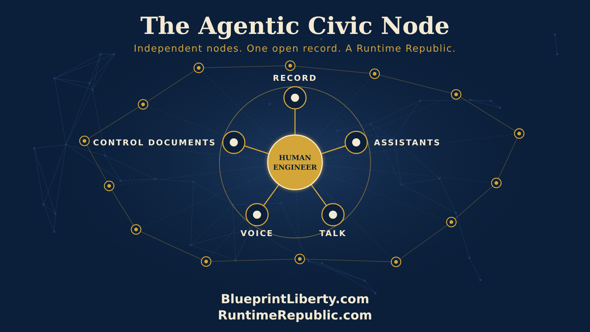

# The Agentic Civic Node

Course: The Agentic Civic Node
Lesson: 01 of 06
Status: Approved
Runtime: about 6 minutes
Image: 01-the-agentic-civic-node.png
Podcast: Not recorded
Sources: None
Approved by: James A. Hodges, 2026-11-05
License: CC BY 4.0
Audience: Citizens and groups starting or growing an Agentic Civic Node

---

Here's something worth paying attention to.

Right now, in Kansas, a small group of citizens is building something that has never quite existed before. It isn't a political party, and it isn't a pressure group. It's closer to a workshop: a place where anyone can help write the rules we all live under, in the open, with every word on the record.

It started with one simple idea. Every bill should be public for at least one hour before anyone votes on it. One hour. That's enough time for a citizen, a reporter or a lawmaker to actually read what's about to become law. It seems obvious. And yet, again and again, bills are gutted and replaced and voted on before anyone outside the room can read a single line. That idea, the One-Hour Rule, became a project. The project became a method. And the method is becoming something much bigger.

So let's give that bigger thing a name. We call it an **Agentic Civic Node**.

Here's what that means. A node is a single point in a network, small on its own but powerful when connected. Our frameworks already think this way. They're built node by node, from the nation down to the state, the county, the city and the school board. An Agentic Civic Node is one group of citizens, organized around a cause, running a complete system for getting public work done in the open. And "agentic" means it has AI agents working inside it, under human control.

Every Agentic Civic Node has the same five parts.

First, **a record.** The node keeps its work on GitHub, the same platform the world's software is built on. Every proposal, every comment and every change is written down, dated and kept. Nothing is decided in a back room, because there is no back room. If it isn't in the record, it didn't happen.

Second, **assistants.** AI agents help members read long bills, check facts, research history and draft language. But they never decide. A person we call the Human Engineer approves every step, and every agent works within enumerated powers, the same way we believe government should.

Third, **a place to talk.** A Discord server, a Facebook group, somewhere people can ask questions, swap ideas and get to know each other. The rule is simple: talk happens there, and the record lives on GitHub. Good talk turns into an issue, an issue turns into a proposal, and a proposal is reviewed in the open.

Fourth, **a voice.** Essays that teach, narrated as podcasts. A YouTube channel organized the way the teams are organized: by place, by issue and by principle. Every video traces back to its record, so anyone can check where it came from.

Fifth, **control documents.** These are the written rules for how the node runs and how every app is used. They're written once and followed everywhere. A node doesn't run on personalities. It runs on rules anyone can read. And beside the rules, every node keeps two short pages: what it has learned, and what works best. Its lessons learned and its best practices.

Inside a node, people grow. Volunteers start at Level 1 and earn their way up by doing real work in public view. Nobody skips ahead, and nobody is left guessing where they stand, because the record tells them, and so does their own AI assistant.

Now here's where it gets exciting. Runtime Republic isn't building just one node. We're building the kit. Any group that shares our ideals, whether it's a property tax group, a parents' group or a transparency group, can stand up its own Agentic Civic Node. It can start as a team inside an existing node, with help close by, or stand up its own GitHub organization from day one. Either way, it gets its own repositories, its own assistants and its own place to talk. And it stays independent. It owns its accounts, its data and its decisions, and we never run them. Everything we teach is free to reuse. What connects the nodes isn't control. It's shared method, shared standards and shared purpose.

And shared learning. Every node tags its work with its cause, like fairtax, so the network can find it. Each morning, before the sun is up, an AI agent reads every node working on that cause, in every organization. It reports what moved, what's waiting, and most important, what each node learned. A lesson learned in one county becomes a best practice in the next by breakfast. The agent only reads and reports. It never runs anyone's node.

The same offer goes to candidates and office holders, of every party, who want to work in the open: the same tools, the same terms, the same rules.

Picture where this leads. One node in Kansas. Then a dozen across the state. Then county nodes watching their commissions, school board nodes reading every budget line, statehouse nodes timing every bill from posting to vote. Each one independent. Each one on the record. All of them connected.

Someone once said that politics is the art of associations. This is that art, rebuilt for the age of agents.

When enough nodes connect, you get something new. A government that can't hide its work, because citizens can see it, check it and help do it. A government judged by its results, not its promises.

That's a Runtime Republic.

And the first node is already running.

<!-- series-navigation: start -->

---

### Continue reading

[Series index](../README.md) · [Next essay →](../02-getting-started-as-a-group/lesson.md)

[All series in this repository](../../README.md) · [Repository home](../../../README.md)

<!-- series-navigation: end -->
