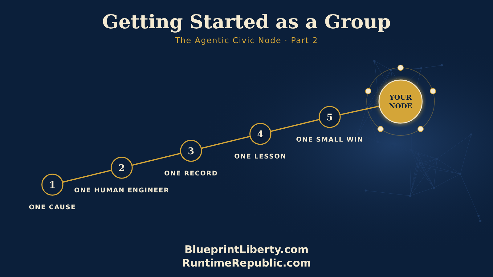

# Getting Started as a Group

Course: The Agentic Civic Node
Lesson: 02 of 06
Status: Draft
Runtime: about 4 minutes
Image: 02-getting-started-as-a-group.png
Podcast: Not recorded
Sources: None
Approved by: James A. Hodges, 2026-11-05
License: CC BY 4.0
Audience: Citizens and groups starting or growing an Agentic Civic Node

---

So you want to start an Agentic Civic Node. Good. Here's the best way to begin, and it's simpler than you might think.

Start with one cause. Not five. One. Maybe it's property taxes in your county. Maybe it's how your school board posts its budget. Maybe it's how long bills sit in public before a vote. Pick the one thing your group cares about most, and write it down in a single sentence. That sentence is your node's purpose. Everything else grows from it.

Next, choose your Human Engineer. This is the one person who approves the work. Not the loudest voice, and not necessarily the founder. Choose the person who will read carefully, say no when something isn't ready, and sign their name to what goes out. Every node needs one steady hand.

Then build your record. You have two ways to start, and both work. You can begin as a team inside an existing node's GitHub organization, learning the method with experienced people close by. Or you can create a free GitHub organization in your group's name right away. If you start as a team, you can move out on your own whenever you're ready, and your whole history comes with you.

Either way, make your first repository. Put five things in it on day one: your purpose sentence, a short list of rules, a page that says how someone can join, and two pages titled Lessons Learned and Best Practices. They'll be empty at first. They won't stay that way. Then tag the repository with your cause, like fairtax, and your place, like us-ks. That tag is how the rest of the network finds you. That's it. You don't need software. You don't need a budget. You need a place where the work is written down, where everyone can see it.

Now connect your assistants. Each member who's ready sets up an AI assistant, like Claude, ChatGPT or Grok, and connects it to your repository. From that moment, their assistant can read your work, explain it, and help them find where they fit. The assistant helps. The Human Engineer decides.

Open a place to talk, but keep it small. One Discord server with a welcome room, a rules room, one room for general talk, and one room where GitHub posts its updates automatically. Add rooms only when people ask for them. An empty room feels lonely. A busy one feels alive.

Write your first control document. Just one page to start: what your node does, what it never does, and how work moves from a draft to approved. You can borrow ours. Everything Runtime Republic teaches is free to reuse. Take it, change it, make it yours.

Then do one real thing. Pick one small piece of public work, like reading one bill, timing one posting, or reviewing one budget line, and do it in the open, start to finish. When it's done, share it. Your first finished piece teaches your members more than any training can.

Finally, invite people in at Level 1. Let them earn their way up by doing real work in public view.

When that first piece of work is done, write down one thing you learned. Put it in your Lessons Learned page. That habit, started on day one, is what makes a node smarter every week.

One cause. One Human Engineer. One record. One small win. One lesson learned.

That's how a node begins. And once it's running, you're never building alone, because every node connects to the rest.

<!-- series-navigation: start -->

---

### Continue reading

[← Previous essay](../01-the-agentic-civic-node/lesson.md) · [Series index](../README.md) · [Next essay →](../03-rules-that-grow/lesson.md)

[All series in this repository](../../README.md) · [Repository home](../../../README.md)

<!-- series-navigation: end -->
