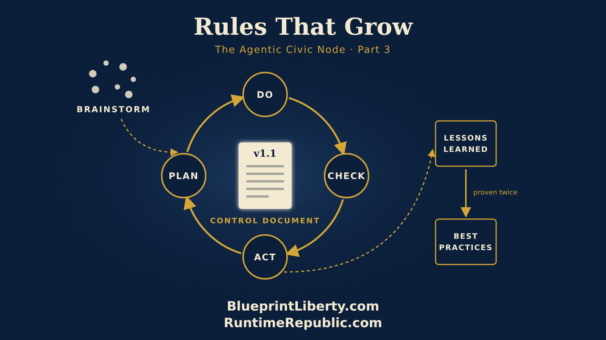

# Rules That Grow: Building Control Documents as You Go

Course: The Agentic Civic Node
Lesson: 03 of 06
Status: Approved
Runtime: about 6 minutes
Image: 03-rules-that-grow.png
Podcast: Not recorded
Sources: None
Approved by: James A. Hodges, 2026-11-05
License: CC BY 4.0
Audience: Citizens and groups starting or growing an Agentic Civic Node

---

Here's a mistake almost every new group makes. They sit down on the first night and try to write the perfect rulebook. Bylaws, procedures, every possible situation. Three meetings later, they're still arguing about section four, and nothing real has happened.

There's a better way. Write your rules as you go. Do one real thing, write down how you did it, then do it better the next time. Your rules grow out of your work, not ahead of it.

We call these written rules control documents. And in an Agentic Civic Node, they matter more than ever, for one reason: your AI assistants.

Think about what an AI assistant actually knows about your group. On its own, nothing. It doesn't know your cause, your rules, or what you decided last Tuesday. It can't read your mind, and it can't read a conversation that was never written down. But give it a control document, a clear page that says what you do, how you do it, and what you never do, and suddenly it becomes a useful agent. It can check a draft against your rules. It can tell a new member the next step. It can say, "That isn't how our group does it, and here's why."

An agent is only as good as the instructions it can read. Unwritten rules make a confused agent. Written rules make a helpful one.

So how do you write rules as you go? We use a simple loop, older than any of us. It's called PDCA: Plan, Do, Check, Act. It came out of American factories in the last century, and it works just as well for a citizens' group.

But before the loop, there's one more step: brainstorming. When your group faces something new, first get every idea on the table. No judging, no arguing, no "that'll never work." Just ideas, written down where everyone can see them. Then you pick the best ones and start the loop.

Let's walk through a real example.

Say your node cares about property taxes, and you want your state senator to answer a question, in public, on the record.

**Brainstorm.** Your members toss out ideas. Phone calls. A petition. A rally. A letter from each member. Someone says, "What if every letter asked the senator to post a public answer we can link to?" That's the one. Each member sends their own letter, all on the same day, each asking for a public response.

**Plan.** Now you write it down. This is your first control document for letters, and it's short. It says the letters all go out on the same day. Each member writes and signs their own letter, in their own words, from their own address. No fake names, and no letters from people who don't live in the district. That rule matters, because one honest letter from a real constituent is worth more than a hundred copies. Every letter asks the same question, and every letter invites the senator to answer publicly so the answer can be linked in your record. And one more line: you're asking a question, not making a threat.

Your AI assistants read that plan. Now each member can ask their own assistant, "Help me write my letter," and the assistant knows the rules. It helps them put the question in their own words. It reminds them to use their real name.

**Do.** The letters go out. Twelve members, twelve letters, one day.

**Check.** Two weeks later, your group looks at what happened. Did everyone send theirs? Nine did, three forgot. Did the senator respond? Yes, a short public statement, and it's now linked in your record for anyone to read. What went wrong? Three letters went to an old address. And one member asked a different question, which muddied the message.

**Act.** Now you improve the control document. You add a line with the correct office address, checked the week before. You add a reminder the day before sending. You add a rule that the question is copied exactly, while the rest of the letter is in the member's own words. Version 1.0 becomes version 1.1.

And you write each lesson down, one line apiece, in your node's Lessons Learned page: "Check the office address the week before." When a lesson proves itself more than once, it graduates to your Best Practices page. Lessons learned are what happened to us. Best practices are what we now always do.

And here's the beautiful part. The next time your group sends letters, to a different senator or about a different issue, you don't start from scratch. You start from version 1.1. Your assistants already know the improved rules. New members learn the method on day one. Every cycle, your group gets a little smarter, and that knowledge stays in the record instead of in one person's head.

It doesn't stay in your node, either. Each morning, an AI agent reads the lessons learned and best practices of every node working on the same cause and shares them in a daily status. Your missing-address lesson reaches a node in another county before they send their first letter. One group's mistake becomes everyone's best practice.

That's how control documents should grow. Not all at once, but one loop at a time: brainstorm, plan, do, check, act. Write it down, and do it better.

Rules that grow from real work. Lessons written down. Agents that can read them and share them. A record that remembers.

That's how a node gets stronger.

<!-- series-navigation: start -->

---

### Continue reading

[← Previous essay](../02-getting-started-as-a-group/lesson.md) · [Series index](../README.md) · [Next essay →](../04-when-a-node-grows/lesson.md)

[All series in this repository](../../README.md) · [Repository home](../../../README.md)

<!-- series-navigation: end -->
