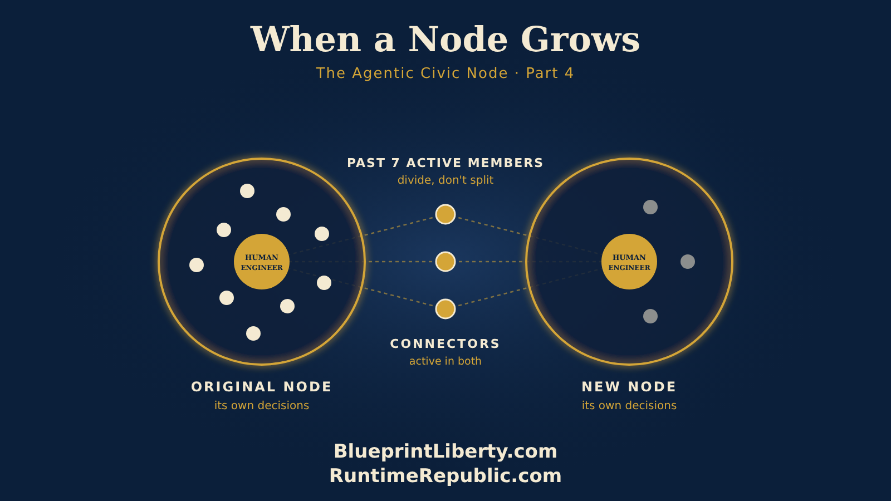

# When a Node Grows: Seven Members and the Art of Dividing

Course: The Agentic Civic Node
Lesson: 04 of 06
Status: Approved
Runtime: about 6 minutes
Image: 04-when-a-node-grows.png
Podcast: Not recorded
Sources: None
Approved by: James A. Hodges, 2026-11-05
License: CC BY 4.0
Audience: Citizens and groups starting or growing an Agentic Civic Node

---

Something good happens to a node that works. People notice. The letters went out, the senator answered on the record, and now your members are telling their neighbors. New people start asking how to join. Before long, your little group of five is ten, then fifteen.

That's success. But it brings a quiet danger.

Big groups slow down. When there are three people in a room, everyone talks. When there are twenty, a few people talk and the rest watch. Meetings get longer. Decisions get harder. People who used to do real work start waiting to be told what to do. And slowly, without anyone meaning it, the group stops being a workshop and becomes an audience.

So here's our rule of thumb. When a node grows past about seven active members, it's time to think about dividing.

Not splitting up. Dividing, the way a healthy cell divides. One becomes two, and both are alive.

Here's how it works. Let's go back to our property tax node. It's grown to twelve members, and three of them live in the next county over. Most of the node's meetings happen on Discord, but now and then they drive over to meet in person, and they keep saying the same thing: "Our county commission has the same problem, and nobody's watching it."

That's the signal. Those three members are ready to stand up their own node.

They start the same way every node starts, the way we talked about in Part 2. One cause: property taxes in their own county. One Human Engineer: they choose one of the three, someone who'll read carefully and say no when something isn't ready. One place to talk: their own Discord server.

And one record. Here, the new node has a choice.

It can start as a team inside the original node's GitHub organization. Think of it as a nest. The new group gets its own repositories and its own team, with experienced members close by to answer questions. It learns the method with a safety net.

Or it can stand up its own GitHub organization from day one, fully on its own.

Both paths are good, and the choice belongs to the new group. A group that starts in the nest can leave whenever it's ready. When it has its cause, its Human Engineer, and its first finished piece of work, it creates its own organization and moves its repositories there. Its whole history goes with it, every issue, every comment, every change. Nothing is lost. We call that graduating.

Either way, the new node doesn't start from zero. Not even close.

Remember the letters? The first node already ran that campaign and improved its control document from version 1.0 to 1.1. The new node copies it on day one. It also copies the Lessons Learned and Best Practices pages, so it knows that the office address gets checked the week before, without ever making that mistake itself. Everything we teach is free to reuse. The new node takes it, changes the senator's name to its own county commissioner, and it's ready. Its AI assistants read the same proven rules. The new node starts where the old one left off.

That's the real power of writing things down. Knowledge doesn't stay in one group. It travels.

Now, here's the part that holds the network together. The three founders stay active in both groups.

They still belong to the original node. They still help with its work, still join its talks, still send their letters when it runs a campaign. And they lead the new node too. They become connectors, people with a foot in each group, carrying lessons back and forth. One GitHub account can belong to many organizations, so a connector simply switches between them. When the new node learns something, say a better way to time a commission meeting, the connectors bring it home. When the original node improves a control document, the connectors carry it out.

But being in both groups comes with one clear rule. Each node makes its own decisions. The original node doesn't run the new one, and the new one doesn't run the original. Even in the nest, the new node has its own Human Engineer and its own say. A connector can bring an idea from one group to the other, but they can't make a decision for the other group. The new node is a partner, not a branch office.

That keeps every node free. And free nodes are strong nodes.

The groups stay linked in simple ways. The new node's Discord follows the original's announcements, so news flows across. Each group links to the other's record. And in the next part, we'll see how one small tag lets the whole network learn from every node, every morning.

Then something remarkable happens. The original node, now back to nine members, starts growing again. And in a few months, another three are ready to stand up a node of their own. Maybe for the school board this time. Maybe for the city council.

One node becomes two. Two become four. Each one small enough that everyone works. Each one connected by people who belong to more than one. Each one independent, on the record, and running on rules that grow.

That's not a club getting bigger. That's a network coming alive.

And here's the last step, because it's the same loop as always. When your node divides for the first time, write down how you did it. What went well, what was hard, and what you'd do differently. Put it in your Lessons Learned page. That becomes your next control document: how a node grows. Plan, do, check, act.

Small groups. Shared rules. Connected people. Lessons that travel.

That's how a Runtime Republic spreads.

<!-- series-navigation: start -->

---

### Continue reading

[← Previous essay](../03-rules-that-grow/lesson.md) · [Series index](../README.md) · [Next essay →](../05-lessons-that-travel/lesson.md)

[All series in this repository](../../README.md) · [Repository home](../../../README.md)

<!-- series-navigation: end -->
