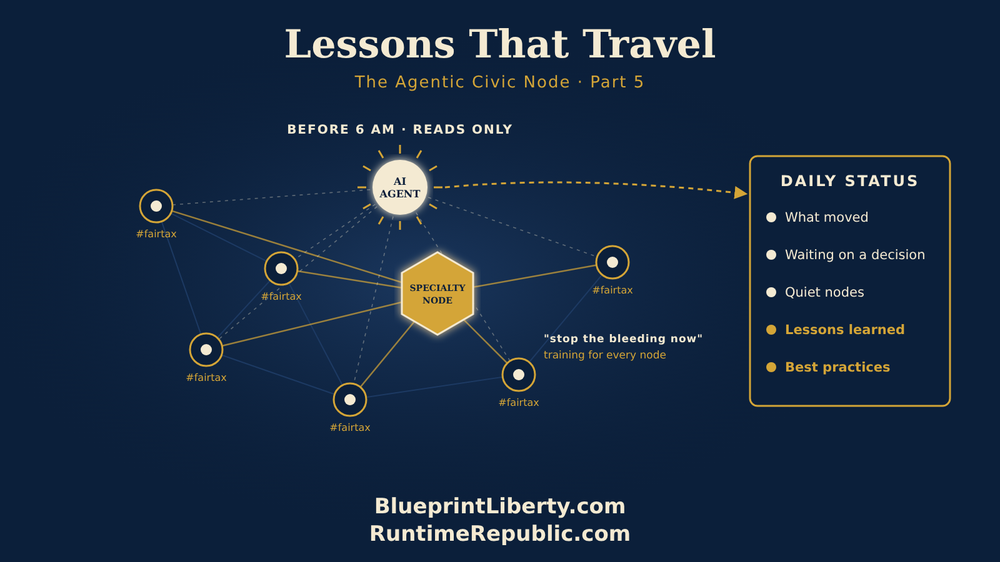

# Lessons That Travel: Specialty Nodes and the Morning Report

Course: The Agentic Civic Node
Lesson: 05 of 06
Status: Approved
Runtime: about 4 minutes
Image: 05-lessons-that-travel.png
Podcast: Not recorded
Sources: None
Approved by: James A. Hodges, 2026-11-05
License: CC BY 4.0
Audience: Citizens and groups starting or growing an Agentic Civic Node

---

In the last part, we watched a node divide. Three members stood up a new node in the next county, stayed active in both, and carried what they knew back and forth. Today we'll look at two more ways a network gets stronger: lessons that travel on their own, and nodes that grow by skill instead of by place.

Start with a small thing. A tag.

Every node tags its repositories with its cause and its place, like fairtax and us-ks. It takes a minute. It looks like nothing. But that tag does something powerful.

Each morning, before six o'clock, an AI agent searches every organization for repositories carrying the tag. It reads what changed overnight. Then it sends a daily status: which nodes moved, what's waiting for a decision, which nodes have gone quiet, and, most important, every new lesson learned and every best practice worth sharing. A node in one county learns from a node in another before breakfast. The agent only reads and reports. It never comments, never changes anything, and never runs anyone's node. It just makes sure no lesson stays lonely.

And when a cause is bigger than one county, like a statewide bill, the nodes can run a joint project: one shared plan, written down, with each group's role agreed in writing.

Not every node divides by place. Some divide by skill.

Here's how that looks. Back in our property tax node, a few members keep getting the same phone calls. A neighbor's valuation notice just jumped, and they don't know what to do. The long fight to change the law matters. But for that family, the bill is due now. So these members start helping people dispute their property assessments. They walk a homeowner through finding comparable sales, gathering photos of needed repairs, and meeting the deadline, which is always shorter than people expect.

They call it "stop the bleeding now."

It works so well that they become a node of their own: a specialty node. Its cause isn't one county. It's one skill, done well, for anyone who needs it. And it keeps one firm line in its control documents. Members help homeowners prepare and file their own appeals. They don't represent anyone, and they don't give legal advice. The homeowner stays in charge of their own case.

Then the specialty node does something even more valuable. It turns what it learns into training. Every appeal teaches a lesson, and every lesson goes into its Lessons Learned page. The ones that keep proving true become best practices, then a checklist, then a short course that any node in the state can use. A brand new node in a far corner of Kansas can start helping its own neighbors on day one, because the specialty node already wrote down how.

That's a different kind of growth. Place nodes spread the work across the map. Specialty nodes deepen it, and serve every node at once. The daily status carries their best practices to every group that shares the cause, so one team's skill becomes the whole network's strength.

So now you have three ways a network grows. Nodes divide by place, so the work covers the map. Nodes grow by skill, so the work gets deeper. And every morning, the lessons travel on their own, so no node has to learn the hard way what another node already knows.

And the loop never changes. When your specialty node runs its first training, write down what worked and what didn't. Put it in your Lessons Learned page. Plan, do, check, act.

Shared tags. Shared lessons. Shared skill.

That's how a network learns faster than any one group ever could.

<!-- series-navigation: start -->

---

### Continue reading

[← Previous essay](../04-when-a-node-grows/lesson.md) · [Series index](../README.md) · [Next essay →](../06-your-node-starts-now/lesson.md)

[All series in this repository](../../README.md) · [Repository home](../../../README.md)

<!-- series-navigation: end -->
