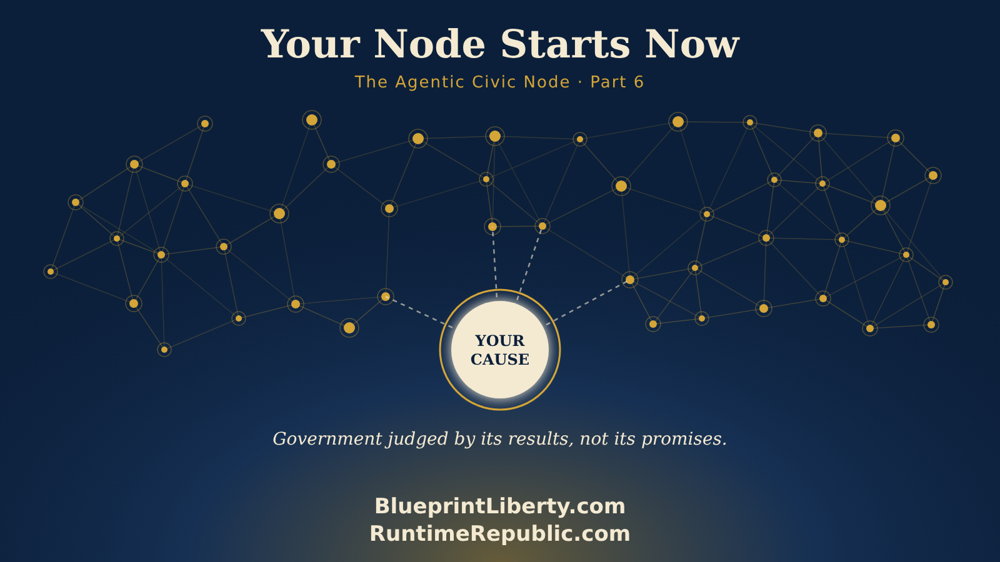

# Your Node Starts Now: The Agentic Civic Node in Review

Course: The Agentic Civic Node
Lesson: 06 of 06
Status: Approved
Runtime: about 4 minutes
Image: 06-your-node-starts-now.png
Podcast: Not recorded
Sources: None
Approved by: James A. Hodges, 2026-11-05
License: CC BY 4.0
Audience: Citizens and groups starting or growing an Agentic Civic Node

---

We've come a long way in this series, so let's look back at the whole picture, and then let's talk about you.

In Part 1, we gave a name to something new: the Agentic Civic Node. One group of citizens, one cause, working in the open, with AI agents helping under human control. Every node has five parts. A record, kept on GitHub, where nothing is decided in a back room. Assistants, AI agents that read, research and draft, but never decide. A place to talk, like Discord, where good conversation turns into good work. A voice, essays and videos that share what's been approved. And control documents, the written rules anyone can read.

In Part 2, we started a node. One cause, written in a single sentence. One Human Engineer, the steady hand who approves the work. One record, either a team inside an existing node or an organization of your own. Two pages on day one: Lessons Learned and Best Practices. And one small, real win, done in the open.

In Part 3, we learned how rules grow. Not all at once, but one loop at a time. Brainstorm, then plan, do, check, act. We watched a group send honest letters, each member in their own words, inviting a senator to answer on the record. Then we watched that group make its rules better for next time. And we saw why written rules matter so much now. An AI agent is only as useful as the instructions it can read.

In Part 4, we watched a node divide. Past about seven active members, a group starts to slow down, so three members stood up a new node of their own. They started in the nest or on their own, carried proven rules with them, and stayed active in both groups as connectors. Each node kept its own decisions. Partners, not branch offices.

In Part 5, we watched lessons travel. A simple tag lets a morning agent read every node working on the same cause and report what each one learned, before six o'clock. And we met the specialty node, a team that helps homeowners dispute their own assessments, "stop the bleeding now," and turns every lesson into training for nodes across the state.

Put it all together, and here's what you have. Small groups that stay active. Rules that grow from real work. Agents that make every member more capable. A record that remembers. And a network that learns faster than any one group ever could.

That's the method. But a method on paper doesn't change anything. People do.

So here's the question this series has been building toward. What's your cause?

Maybe it's property taxes. Maybe it's how your school board spends its budget. Maybe it's how long a bill sits in public before a vote. Whatever it is, you don't need permission to start. You don't need money, an office, or a hundred members. You need one sentence, one steady hand, one record, and the willingness to do one real thing in the open.

And you won't be alone. Everything Runtime Republic teaches is free to reuse. The rules are written. The lessons are recorded. Other nodes are already running, and every morning, what they learn can reach you.

Someone once said that politics is the art of associations. For a long time, that art belonged to the people with the biggest offices and the deepest pockets. Not anymore. With open records, honest rules and AI agents working for ordinary citizens, the art of associations belongs to anyone willing to practice it.

Government that can't hide its work. Citizens who can see it, check it, and help do it. Government judged by its results, not its promises.

That's a Runtime Republic.

Your node starts now.

<!-- series-navigation: start -->

---

### Continue reading

[← Previous essay](../05-lessons-that-travel/lesson.md) · [Series index](../README.md)

[All series in this repository](../../README.md) · [Repository home](../../../README.md)

<!-- series-navigation: end -->
